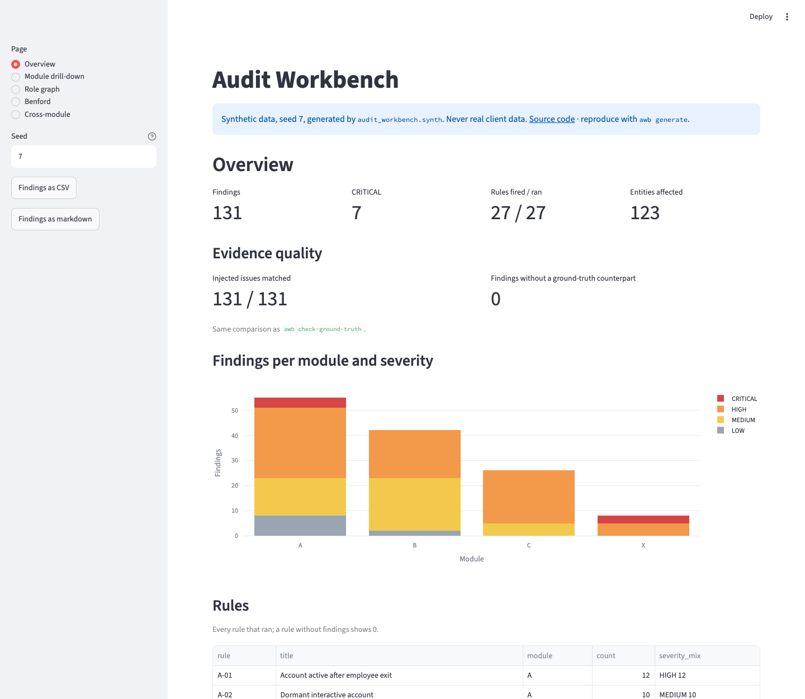
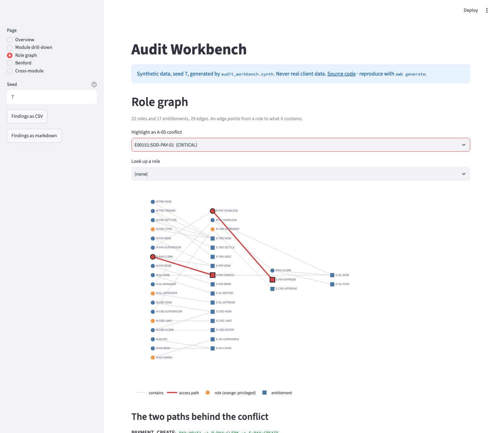

# Audit Workbench

[](https://github.com/eugen-goebel/audit-workbench/actions/workflows/ci.yml)
[](https://github.com/eugen-goebel/audit-workbench/actions/workflows/codeql.yml)


Data-driven IT audit tests for banks: access review, segregation of duties, journal entry testing and change management. Everything runs on a synthetic bank with known, injected issues, so every detection rule can be checked against ground truth.

> **Status:** modules A (access review and segregation of duties), B (journal entry testing), C (change management) and X (cross-module cases) are complete, and so are the audit workpaper (DOCX and PDF) and the dashboard (Streamlit). Live demo on seed 7: [audit-workbench.streamlit.app](https://audit-workbench.streamlit.app).

## Scope and boundaries

- **Synthetic data only.** All data comes from the built-in generator. No real or anonymised data from any bank, client or employer.
- **Public sources only.** Rules are based on publicly available material: Regulation (EU) 2022/2554 (DORA), BaFin publications and published statistical methods. No internal methodology of any audit firm.
- **DORA first.** DORA has applied since 17 January 2025. BaFin repeals the BAIT completely with effect from 31 December 2026, so BAIT appears only as a legacy reference.

## Quick start

```bash
uv sync
uv run awb generate data/generated/demo --seed 7   # build the synthetic bank
uv run awb run data/generated/demo                 # run all rules (modules A, B and C)
uv run awb run data/generated/demo --module b      # journal entries only
uv run awb run data/generated/demo --module c      # change management only
uv run awb explain data/generated/demo <finding-id>
uv run awb benford data/generated/demo --by employee   # digit tables behind B-01/B-02
uv run awb check-ground-truth data/generated/demo  # compare against the injected issues

uv sync --extra workpaper                          # once: python-docx and reportlab for the workpaper
uv run awb workpaper data/generated/demo --preparer "A. Auditor"      # writes workpaper.docx
uv run awb workpaper data/generated/demo --output demo.pdf            # the same, as PDF

uv sync --extra dashboard                          # once: streamlit and plotly for the dashboard
uv run awb dashboard                               # generates seed 7 and serves http://127.0.0.1:8501
```

## Module A: access review and segregation of duties

Eight rules, specified in [docs/design/module-a-access.md](docs/design/module-a-access.md):

| Rule | What it finds |
|---|---|
| A-01 | Account still active after the employee left |
| A-02 | Interactive account unused for more than 90 days |
| A-03 | Shared (generic) account that allows interactive login |
| A-04 | Privileged access without recertification in the last 12 months, including privilege inherited through nested roles |
| A-05 | One employee holds two conflicting business functions, across all of their accounts and through nested roles |
| A-06 | Recertification done without care: reviewers approving their own access, or clicking through most items in under five seconds |
| A-07 | Personal account without a matching HR record |
| A-08 | Role that fewer than 10 % of the employee's peer group holds |

## Module B: journal entry testing

Ten rules on the general ledger, specified in [docs/design/module-b-journal.md](docs/design/module-b-journal.md). The population follows ISA 240 (Revised) paragraphs 48 and 49: completeness of the journal entries, entries at period end and entries throughout the period. The revised standard applies to audits of periods beginning on or after 15 December 2026 (para. 16), so for the synthetic 2025 ledger it is ahead of time; it is cited because the workbench targets the audits that come next, and the journal entry procedures of the previous ISA 240 cover the same ground under other paragraph numbers.

| Rule | What it finds |
|---|---|
| B-01 | A preparer's manual amounts do not follow Benford's law in the first digit (MAD above 0.015) |
| B-02 | A GL account's amounts do not follow Benford's law in the first two digits (MAD above 0.0022) |
| B-03 | Share of round amounts per preparer above 25 % (at least 30 entries) |
| B-04 | Manual entry on a weekend or a Hessen public holiday |
| B-05 | Manual entry after the period was closed, or reversed within 10 days |
| B-06 | Gaps or duplicates in the document number ranges (GoBD completeness) |
| B-07 | The same entry posted twice within 7 days (same amount, accounts, preparer and text) |
| B-08 | Manual entry above the approval limit without a second, different approver |
| B-09 | Rare debit/credit account combination (fewer than 3 entries per year on an income, equity or suspense account) |
| B-10 | Manual entry keyed by someone outside the accounting department or by a system administrator |

The Benford rules judge a group only above a minimum size, because the MAD of even perfectly Benford-conforming amounts grows as the sample shrinks. A simulation in the test suite shows why: at 300 amounts, more than 20 % of clean samples exceed the 0.015 limit; at 1,000, none do. `awb benford` lists every group, including the ones too small to judge.

The anomaly ranking (`awb run --rank N`) scores manual entries with an Isolation Forest. It is a sampling aid for choosing entries to inspect and deliberately produces no findings: a score without an explainable threshold cannot be defended in an audit.

## Module C: change management

Six rules on change tickets, approvals, commits and production deployments, specified in [docs/design/module-c-change.md](docs/design/module-c-change.md). They follow DORA Article 9(4)(e), which requires that all changes to ICT systems are "recorded, tested, assessed, approved, implemented and verified in a controlled manner", and Article 17(1) of Commission Delegated Regulation (EU) 2024/1774, which lists what an ICT change management procedure must contain.

| Rule | What it finds |
|---|---|
| C-01 | Production deployment without an approved change: no ticket, an unknown ticket, a ticket of another system, or a normal change that was never approved |
| C-02 | The developer of a change deployed it to production, either by hand (also with a second account) or by releasing the pipeline run |
| C-03 | Emergency change without approval afterwards, or approved more than 7 days after the deployment |
| C-04 | No approval was in force when the change first reached production |
| C-05 | The approver requested the change or wrote code for it (RTS Art. 17(1)(b)) |
| C-06 | Medium or high risk change deployed without a test sign-off, with a late one, or tested by its own developer |

Who built a change comes from the commit authors, not from a field in the ticket. A pipeline deployment runs under a technical account, so the rules look at the person who released it. As in modules A and B, people are compared as employees, not as accounts.

## Module X: cross-module cases

Module A reports a segregation-of-duties conflict as a *risk*: the employee could post and approve. Module X asks whether the risk was *used*. Three rules join the access, journal and change data, specified in [docs/design/phase-4-crosslink.md](docs/design/phase-4-crosslink.md).

| Rule | What it finds |
|---|---|
| X-01 | An employee holds two conflicting functions and prepared and approved the same manual journal entry |
| X-02 | An action in the journal or change data that no right of the acting account covers on that day |
| X-03 | Activity after the exit date: commits, deployments or journal entries by a leaver after their last working day |

Every rule asks what was held **when the action happened**, not on the audit date. An account holds a function at day *d* when it exists at *d* and has an assignment valid at *d* to a role that contains the function, directly or through the role hierarchy. So a right granted in July does not cover a March action, and a right withdrawn in April does not stop an August action from being flagged.

The bank plants 8 cross-module cases (X-01 2, X-02 4, X-03 2) and near misses that must not be flagged: a right granted after the ledger year, an approver acting on their own change but not on a journal entry, and an action on the exit date itself.

### Regulation mapping and sampling

Two smaller parts complete the workflow. `regulation/mapping.yaml` maps every rule id to the provision it tests, with a verbatim quote and the official URL; the quote is checked against the stored text in `regulation/sources/` on every test run, so a citation cannot rot. Findings carry their references, for example `DORA Art. 9(4)(c): access limited to approved functions`.

For controls that no rule can test (is the test evidence in the change ticket adequate?), `awb sample` draws an attribute sample from one population and `awb sample-size` computes the size without data. The size follows the confidence, tolerable and expected deviation rate; the items come from a seeded permutation, and the sample file records the population, the input file SHA-256, the size, the seed and every parameter, so the sample is reproducible and defensible later. ISA 530 paragraph 8 requires that every sampling unit has a chance of selection, which the permutation guarantees.

### Audit workpaper (DOCX and PDF)

`awb run` lists findings; what an audit team files is a workpaper that a reviewer can read without the tool. `awb workpaper` writes one run as a document whose structure follows ISA 230 *Audit Documentation* (paras. 8 and 9): cover, data basis, procedures, results, findings, samples, significant matters and sign-off. The format follows the file suffix:

```bash
uv sync --extra workpaper                                  # python-docx and reportlab (optional extra)
uv run awb workpaper data/generated/demo --preparer "A. Auditor"          # DATA_DIR/workpaper.docx
uv run awb sample data/generated/demo --population changes --output s_changes.csv
uv run awb workpaper data/generated/demo --output demo.pdf --sample s_changes.csv --min-severity medium
```

Every number comes from the run. The document model is built once and rendered twice, so DOCX (real Word headings and tables, to complete in Word) and PDF (A4, page numbers, the data hash of the run in the footer of every page) carry the same text. `--sample` attaches files written by `awb sample` as section 6; a sample drawn from different data than the folder (its population hash does not match) is rejected with exit code 1. `SOURCE_DATE_EPOCH` fixes the run date, so the same data gives the same text. Without the extra, `awb workpaper` stops with a message naming it and all other commands keep working.

What needs an auditor's judgment stays visibly open: the conclusions of section 7 (one row per CRITICAL and HIGH finding), the result column of each sample and the reviewer fields of section 8 are empty, and the cover says so. The tool never writes a reviewer or a conclusion. Excerpt of the workpaper for seed 7 (`awb workpaper data/generated/demo --preparer "A. Auditor"` with `SOURCE_DATE_EPOCH=1793577600`), with 2 of its 18 input files and 3 of its 27 rules:

**2. Data basis** (the findings rest on exactly these bytes)

| File | Rows | Columns | SHA-256 |
|---|---|---|---|
| account_roles.csv | 881 | 4 | 0697f1b77fe319dd0316446e720875143c0908baca3d540207392eb37f3a896a |
| accounts.csv | 852 | 8 | 885bdb466c60b37e4b8c557734f337da62047da0001c9fc3b32724b1f009f583 |

**4. Results** (rules without findings are listed too: "tested, no exception" is a result)

| Rule | Title | Low | Medium | High | Critical | Total | Result |
|---|---|---|---|---|---|---|---|
| A-01 | Account active after employee exit | 0 | 0 | 12 | 0 | 12 | 12 exceptions |
| A-02 | Dormant interactive account | 0 | 10 | 0 | 0 | 10 | 10 exceptions |
| A-03 | Generic account with interactive login | 0 | 3 | 0 | 0 | 3 | 3 exceptions |
| Total |  | 10 | 41 | 73 | 7 | 131 |  |

**8. Sign-off**

| Item | Value |
|---|---|
| Prepared by | A. Auditor |
| Date of the run (work completed) | 2026-11-02 |
| Reviewed by |  |
| Date of review |  |
| Extent of review |  |

### Dashboard (Streamlit)

`awb run` prints a table. A reviewer in a meeting asks other questions: how do the findings spread over the modules, where does a segregation-of-duties path run, does the ledger follow Benford, what crosses module boundaries. `awb dashboard` answers them on one screen and computes everything live from the same run, with no database and no precomputed file.

```bash
uv sync --extra dashboard                              # streamlit and plotly (optional extra)
uv run awb dashboard                                   # generate the bank for seed 7 and open the dashboard
uv run awb dashboard data/generated/demo --no-browser  # or read a folder; same loader and rules as awb run
```

`--seed N` generates another bank (`awb generate --seed N` gives the same bytes), `--as-of` and `--module` mean what they mean in `awb run`, `--port` and `--host` choose the address. In the app the seed can also be set in the URL (`?seed=11`); a value that is not a whole number from 0 to 2,147,483,647 is rejected.



Five pages, all taken from one `Run`:

1. **Overview.** Findings, CRITICAL, rules fired out of rules run and entities affected; findings per module and severity; every rule with its count (a rule without findings shows 0); the data basis with row and column counts and the SHA-256 of every input file. With a `ground_truth.json` it also shows the evidence quality, the comparison `awb check-ground-truth` makes. On seed 7: 131 findings, 7 CRITICAL, 27 of 27 rules fired, 131 of 131 injected issues matched and 0 findings without a ground-truth counterpart.
2. **Module drill-down.** Filter one module by severity and rule, then open a finding: what the rule tests, parameters, regulation references with their quote, evidence files with hashes, the access path, journal entry or change record, and the raw rows the finding names.
3. **Role graph.** The role hierarchy as a graph (22 roles, 17 entitlements). Pick an A-05 conflict to highlight its two access paths and the accounts that hold them, or pick a role to see its holders and everything it grants.
4. **Benford.** Observed against expected digits per employee (B-01) or GL account (B-02), with the nonconformity limit. Groups below the sample size the rule needs (1,000 amounts for B-01, 5,000 for B-02) are marked as not testable, not as clean.
5. **Cross-module.** The eight X findings as chains with their linking key and buttons into the findings behind each step.



Both screenshots come from a real run (`awb dashboard`, seed 7). The sidebar offers the findings as CSV and as the markdown table `awb run --format markdown` prints, generated in memory; the dashboard is read-only and writes nothing. The code is split so the logic is testable without a browser: `src/audit_workbench/dashboard/views.py` turns a run into plain data (dataclasses and pandas frames, no Streamlit import, guarded by a test) and `dashboard/app.py` only renders it. `dashboard/requirements.txt` pins the versions for the cloud build.

**Live demo:** [audit-workbench.streamlit.app](https://audit-workbench.streamlit.app) runs the same app on seed 7 on Streamlit Community Cloud, installed from `dashboard/requirements.txt`. An unused app on the free tier goes to sleep; the first visit then wakes it, which takes a minute or two before the bank is generated. A different seed works through the URL, for example `?seed=11`.

### The synthetic bank (all modules)

`awb generate` builds a fictitious bank from a seed: 821 employees in seven org units, 851 accounts on five systems (core banking, payments, general ledger, trading, directory), roles nested up to three levels deep, and one recertification campaign per system. Module B adds a chart of accounts and a fiscal year 2025 with about 60,000 journal entries (about 20 % manual) and 180,000 lines. Module C adds an audit year of change management (1 October 2025 to 30 September 2026): 1,800 changes (1,170 normal, 540 standard, 90 emergency), about 6,100 commits and 1,855 production deployments, 70 % of them through the pipeline and 14 % failed or rolled back before a redeployment. It then injects known issues and writes them to `ground_truth.json`.

The clean bank, without injection, produces no findings in any module. The bank also contains near misses that must not be flagged, for example a leaver whose account is disabled, an account last used 89 days ago, a rare role in a team too small to compare, entries on 24 and 31 December (normal banking days), an amount one cent below the approval limit, a small group whose Benford MAD looks high purely by chance, a standard change deployed without individual approval, an emergency change approved exactly on day 7, and a developer who deploys their own change to the test environment.

### Ground-truth result

Output of `awb check-ground-truth` on the default seed. CI runs the same check on seeds 7 and 11 for every push and publishes the table in the job summary.

| module | rule | title | expected | found | true positives | recall | precision |
|---|---|---|---|---|---|---|---|
| A | A-01 | Account active after employee exit | 12 | 12 | 12 | 100.0% | 100.0% |
| A | A-02 | Dormant interactive account | 10 | 10 | 10 | 100.0% | 100.0% |
| A | A-03 | Generic account with interactive login | 3 | 3 | 3 | 100.0% | 100.0% |
| A | A-04 | Privileged access not recertified | 6 | 6 | 6 | 100.0% | 100.0% |
| A | A-05 | Segregation-of-duties conflict | 9 | 9 | 9 | 100.0% | 100.0% |
| A | A-06 | Recertification rubber stamp | 3 | 3 | 3 | 100.0% | 100.0% |
| A | A-07 | Orphan personal account | 4 | 4 | 4 | 100.0% | 100.0% |
| A | A-08 | Unusual role for peer group | 8 | 8 | 8 | 100.0% | 100.0% |
| B | B-01 | Benford first-digit test per preparer | 1 | 1 | 1 | 100.0% | 100.0% |
| B | B-02 | Benford first-two-digits test per GL account | 1 | 1 | 1 | 100.0% | 100.0% |
| B | B-03 | High share of round amounts per preparer | 2 | 2 | 2 | 100.0% | 100.0% |
| B | B-04 | Manual entry on weekend or public holiday | 6 | 6 | 6 | 100.0% | 100.0% |
| B | B-05 | Post-closing entries and early reversals | 8 | 8 | 8 | 100.0% | 100.0% |
| B | B-06 | Gaps and duplicates in document numbers | 4 | 4 | 4 | 100.0% | 100.0% |
| B | B-07 | Same entry posted twice | 5 | 5 | 5 | 100.0% | 100.0% |
| B | B-08 | Manual entry above the limit not approved by a second person | 6 | 6 | 6 | 100.0% | 100.0% |
| B | B-09 | Rare debit/credit account combination | 5 | 5 | 5 | 100.0% | 100.0% |
| B | B-10 | Manual entry by an unexpected preparer | 4 | 4 | 4 | 100.0% | 100.0% |
| C | C-01 | Production deployment without an approved change | 6 | 6 | 6 | 100.0% | 100.0% |
| C | C-02 | Developer deployed their own change | 5 | 5 | 5 | 100.0% | 100.0% |
| C | C-03 | Emergency change not approved afterwards | 4 | 4 | 4 | 100.0% | 100.0% |
| C | C-04 | Approval came after the deployment | 4 | 4 | 4 | 100.0% | 100.0% |
| C | C-05 | Approver is not independent of the change | 4 | 4 | 4 | 100.0% | 100.0% |
| C | C-06 | Change deployed without test sign-off | 3 | 3 | 3 | 100.0% | 100.0% |
| X | X-01 | Conflicting functions held and used on one transaction | 2 | 2 | 2 | 100.0% | 100.0% |
| X | X-02 | Action not covered by the access data | 4 | 4 | 4 | 100.0% | 100.0% |
| X | X-03 | Activity after the exit date | 2 | 2 | 2 | 100.0% | 100.0% |
| A | **Total A** |  | 55 | 55 | 55 | 100.0% | 100.0% |
| B | **Total B** |  | 42 | 42 | 42 | 100.0% | 100.0% |
| C | **Total C** |  | 26 | 26 | 26 | 100.0% | 100.0% |
| X | **Total X** |  | 8 | 8 | 8 | 100.0% | 100.0% |
|  | **Total** |  | 131 | 131 | 131 | 100.0% | 100.0% |

This shows the rules match their specification on data built to that specification. It says nothing about real-world data quality, which is always messier.

### Explaining a segregation-of-duties conflict

A conflict is only useful if the auditor can see where the access comes from. `awb explain` prints the shortest path from the account to each entitlement:

```text
Finding:     a4cf4ee1ffdddb87
Rule:        A-05 v1.0.0 - Segregation-of-duties conflict
Severity:    HIGH
Entity:      E00461:SOD-GL-01
Description: Employee E00461 holds both GL_POST and GL_APPROVE (Post and approve manual journal entries).
Audit date:  2026-09-30

Access paths:
  GL_POST: GL-00133 -> R-GL-MANAGER -> R-GL-TEAMLEAD -> R-GL-CLERK -> E-GL-POST
  GL_APPROVE: GL-00133 -> R-GL-APPROVER -> E-GL-APPROVE
```

The posting right is not in the assigned role itself. It comes from `R-GL-CLERK`, two levels down (manager contains team lead contains clerk). A review that only looks at directly assigned roles would miss it.

## Design principles

**Reproducible evidence.** Every input file is hashed with SHA-256 when it is loaded. Each finding stores the rule id, the rule version, its parameters (including the audit date) and the hashes of the data it came from. Rerunning a rule on the same data gives the same finding id.

**Rules are versioned.** A rule is one audit test with a stable id (for example `A-01`) and a version. Changing the logic means a new version, so old results stay explainable.

**Fixed audit date.** Every check is relative to the audit date (`as_of`), never to the current clock, so results do not change when the same data is rerun a week later.

## Roadmap

| Module | Audit area | Status |
|---|---|---|
| Core | Evidence loading and hashing, finding model, rule registry | done |
| A | Access review and segregation of duties | done |
| B | Journal entry testing | done |
| C | Change management | done |
| D | Cross-module findings, sampling, DORA mapping | done |
| E | Audit workpaper (DOCX/PDF), dashboard and live demo | done; an HTTP API and a Docker image were specified and deliberately not built ([why](docs/design/phase-5-api-docker.md)) |

## Development

```bash
uv sync --all-extras   # includes the optional workpaper and dashboard extras the tests need
uv run pytest
uv run ruff check . && uv run ruff format --check .
```

## Auf Deutsch

IT-Prüfungshandlungen für Banken, datenbasiert umgesetzt. Fünf Bereiche werden abgedeckt: Berechtigungsprüfung, Funktionstrennung, Journal-Entry-Testing, Change-Management und modulübergreifende Fälle. Getestet wird an einer synthetischen Bank, deren Fehler bekannt sind und absichtlich eingebaut wurden. Dadurch lässt sich jede Prüfregel gegen ein bekanntes Ergebnis prüfen.

Modul A ist die Berechtigungsprüfung und arbeitet mit acht Regeln. Es findet aktive Konten ausgeschiedener Mitarbeiter, Privilegien ohne Rezertifizierung und Verstöße gegen die Funktionstrennung. Auch Verstöße, die erst über mehrere Ebenen vererbter Rollen entstehen, erkennt das Modul. Zu jedem Fund zeigt das Werkzeug den Weg vom Konto bis zur einzelnen Berechtigung.

Modul B übernimmt das Journal-Entry-Testing. Hier laufen zehn Regeln, darunter Benford-Analysen, Buchungen am Periodenende, Lücken in den Belegnummern, Dubletten und fehlende Vier-Augen-Freigabe.

Modul C prüft das Change-Management nach DORA Art. 9 Abs. 4 Buchst. e und Art. 17 der Delegierten Verordnung (EU) 2024/1774. Dafür stehen sechs Regeln. Das Modul findet Deployments ohne genehmigten Change und Entwickler, die ihre eigene Änderung in die Produktion bringen. Außerdem erkennt es Notfalländerungen ohne nachträgliche Freigabe, Freigaben nach dem Deployment, Genehmiger, die den Change selbst beantragt oder programmiert haben, und Änderungen ohne Testabnahme. Wer eine Änderung gebaut hat, ergibt sich aus den Commits, nicht aus einem Feld im Ticket.

Modul X verbindet die drei Datenbestände. Es fragt, ob ein Risiko tatsächlich genutzt wurde: Hat ein Mitarbeiter mit zwei unvereinbaren Funktionen dieselbe Buchung erfasst und freigegeben? Hat ein Konto gehandelt, ohne an diesem Tag das Recht dazu zu haben? War ein ausgeschiedener Mitarbeiter nach seinem letzten Arbeitstag noch aktiv? Maßgeblich ist immer der Tag der Handlung, nicht der Prüfungsstichtag.

Zu jedem Fund nennt das Werkzeug die einschlägige Vorschrift mit wörtlichem Zitat und amtlicher Fundstelle, zum Beispiel DORA Art. 9 Abs. 4 Buchst. c. Die Zitate liegen als Text in `regulation/sources/` und werden bei jedem Testlauf gegen das Zitat in der Zuordnung geprüft. Für Kontrollen, die keine Regel prüfen kann (etwa ob der Nachweis im Change-Ticket ausreicht), zieht `awb sample` eine Stichprobe aus einer Population; `awb sample-size` berechnet den Stichprobenumfang auch ohne Daten. Die Stichprobendatei hält Population, Prüfsumme der Eingabedatei, Umfang, Seed und alle Parameter fest und ist damit reproduzierbar.

`awb workpaper` schreibt aus einem Prüflauf ein Arbeitspapier als Word- und PDF-Datei. Der Aufbau folgt ISA 230: Datenbasis mit Prüfsummen, Prüfschritte, Ergebnisse, Befunde, Stichproben und Abzeichnung. Schlussfolgerungen und die Felder für die Durchsicht bleiben leer, sie füllt der Prüfer aus. `awb dashboard` zeigt dieselben Ergebnisse im Browser, mit Rollengraph, Benford-Diagrammen und den modulübergreifenden Fällen. Eine Live-Demo läuft unter [audit-workbench.streamlit.app](https://audit-workbench.streamlit.app).

Alle Daten sind künstlich erzeugt. Echte Daten kommen nicht vor. Die Prüfregeln beruhen nur auf öffentlichen Quellen, nicht auf der Methodik einer Prüfungsgesellschaft.

## License

MIT
